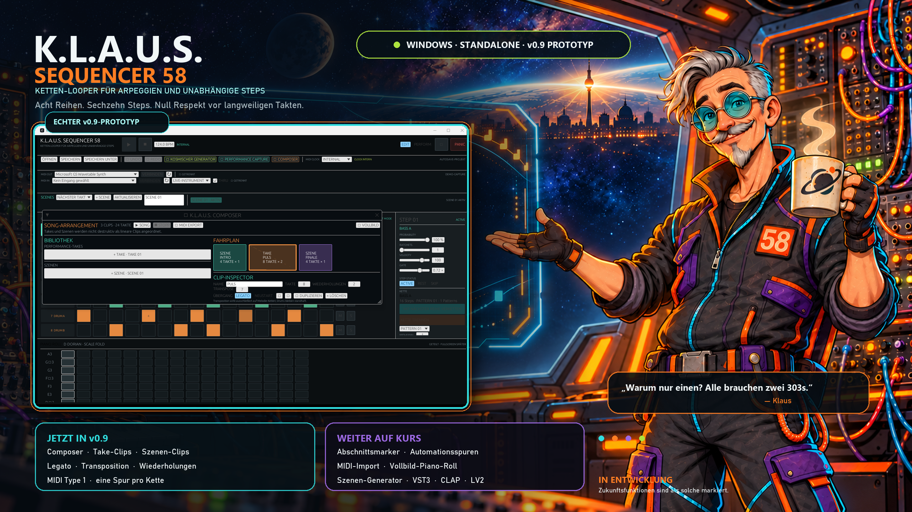

# K.L.A.U.S. Sequencer 58



**Ketten-Looper für Arpeggien und unabhängige Steps**  
Ein touchorientierter, polyphoner MIDI-Stepsequencer für Windows – gebaut in Rust, inspiriert von Berlin School, Modularsystemen, polyrhythmischen Verschiebungen und der begründeten Überzeugung, dass ein Step mehr als eine Note tragen darf.

> „Warum nur einen? Alle brauchen zwei 303s.“  
> — Klaus, vermutlich während einer völlig sachlichen Budgetbesprechung

[](https://github.com/kolkrabeofdoom/klaus-sequencer-58/releases)
[](https://www.rust-lang.org/)
[](#systemanforderungen)
[](#lizenz)
[](#projektstatus)

## Inhalt

- [Was ist K.L.A.U.S.?](#was-ist-klaus)
- [Projektstatus](#projektstatus)
- [Download und Start](#download-und-start)
- [Das Instrument](#das-instrument)
- [Bedienkonzept](#bedienkonzept)
- [MIDI und Live-Spiel](#midi-und-live-spiel)
- [Arpeggiator](#arpeggiator)
- [Kosmischer Generator](#kosmischer-generator)
- [Performance Capture](#performance-capture)
- [Composer und Songmodus](#composer-und-songmodus)
- [MIDI-Export](#midi-export)
- [Patterns und Ketten](#patterns-und-ketten)
- [Piano-Rolls](#piano-rolls)
- [Klaus-Lore](#klaus-lore)
- [Roadmap](#roadmap)
- [Architektur](#architektur)
- [Selbst bauen](#selbst-bauen)
- [Projektdateien und Autosave](#projektdateien-und-autosave)
- [Mitmachen](#mitmachen)
- [Lizenz](#lizenz)

## Was ist K.L.A.U.S.?

K.L.A.U.S. steht für:

> **K**etten-**L**ooper für **A**rpeggien und **u**nabhängige **S**teps

Der Sequencer kombiniert ein unmittelbar spielbares **8×16-Step-Raster** mit polyphonen Piano-Rolls, Drum-Programmierung, verkettbaren Reihen, Live-Eingabe und einem integrierten Arpeggiator. Er ist als eigenständige Windows-Anwendung konzipiert; spätere Plug-in-Adapter werden architektonisch berücksichtigt, ohne das aktuelle Instrument vorschnell in ein Format-Karussell zu werfen.

Die grundlegende Idee ist einfach:

1. Sechs Reihen sind für Melodie, Akkorde, Bass und Arpeggien vorgesehen.
2. Zwei Reihen sind Drum-Spuren mit vollständigem Drum-Piano-Roll.
3. Benachbarte Reihen desselben Typs können zu längeren Ketten verbunden werden.
4. Jede Kette läuft mit eigener Länge, Richtung, Teilung, Swing und MIDI-Route.
5. Steps dürfen aktiv, Pause oder Skip sein und mehrere Noten enthalten.

Das Resultat soll sowohl ein **Live-Instrument** als auch ein **Kompositionssequencer** werden: schnell genug für improvisierte Eingriffe, strukturiert genug für ganze Arrangements und eigensinnig genug, um nicht nach vier Takten um Erlaubnis zu bitten.

## Projektstatus

K.L.A.U.S. ist ein funktionierender **v0.9-Prototyp**. MIDI-Ein- und -Ausgabe, Transport, Ketten, Pattern, Szenen, polyphone Steps, Probability, Ratchets, Live-Skips, Arpeggiator, MIDI-Clock, kreativer Reihengenerator, Performance Capture und der Composer sind real implementiert. Das ist keine statische Designstudie.

Gleichzeitig gilt: Der Prototyp ist noch kein sicherheitskritisches Bühnenbetriebssystem für eine Marsmission. Vor einem Konzert sollte mensch das Setup mit dem eigenen MIDI-Interface und den verwendeten Instrumenten testen.

### Bereits implementiert

- 8 Reihen mit jeweils 16 Steps
- sechs Melodie- und zwei Drum-Reihen
- polyphone Steps mit beliebig mehreren MIDI-Noten
- Melodie- und Drum-Piano-Roll
- Step-Zustände **Active**, **Rest** und **Skip**
- Probability pro Step
- 1–8 Ratchets pro Step
- temporäre Live-Skips pro Step
- globaler Live-Skip-Modus im Performance-Betrieb
- optionales automatisches Löschen von Live-Skips
- Ketten aus benachbarten Reihen desselben Typs
- echte 16/32-Step-Wiedergabe verketteter Reihen
- gleichzeitig laufende Ketten unterschiedlicher Länge
- eigene MIDI-Kanäle, Teilungen und Swing-Werte pro Kette
- Sound-Ziel pro Kette mit Bank Select MSB/LSB und Program Change
- Vorwärts, Rückwärts, Ping-Pong und deterministischer Zufall
- MIDI-Ausgang mit zeitgenauen Note-Offs, Gates und Ratchets
- MIDI-Eingang, MIDI-Thru und Geräteaktualisierung
- Live-Instrument, Akkord-Capture, Step-Record und quantisierte Aufnahme
- Live-Arpeggiator inklusive Latch und Arp-Ratchets
- mehrere Kettenpatterns mit sicherem Patternwechsel
- Szenen für gemeinsame Patternwechsel über alle Ketten
- quantisierte Szenenstarts: sofort, nächster Step, Beat oder Takt
- MIDI-Clock als Internal, Master oder Follower
- MIDI Start, Continue und Stop
- native Projektdateien mit Öffnen, Speichern und Speichern unter
- Undo/Redo mit bis zu 64 vollständigen Projektzuständen
- Rendern eines Arpeggios in ein neues Pattern
- atomisches Autosave mit Wiederherstellung
- MIDI-Panic auf allen 16 Kanälen
- touchfreundliche Oberfläche für Convertibles wie das HP Elite x2 G4
- kreativer Reihengenerator mit Tonart, Rollenprofilen, reproduzierbaren Seeds und Vorschau
- Varianten und anteilige Mutation mit Sperren für Noten, Rhythmus und Ausdruck
- Performance Capture mit persistenter 24-PPQN-Ereignistimeline
- Take-Playback für Szenen, Pattern und Live-Skips
- mehrere benannte Takes mit Duplizieren, Umbenennen und sicherem Löschen
- grafisch und per Touch verschiebbare Timeline-Ereignisse
- gespeicherte Wiederholungsblöcke mit zwei bis sechzehn Durchläufen

### Bewusst noch nicht fertig

- parallele Automationsspuren und Abschnittsmarker im Composer
- Import vorhandener MIDI-Dateien
- Vollbild-Piano-Roll
- VST3-, CLAP- und LV2-Adapter
- bedingte Trigger; im Datenmodell vorgesehen, noch nicht in der Oberfläche

## Download und Start

Die aktuelle Windows-Version befindet sich unter [Releases](https://github.com/kolkrabeofdoom/klaus-sequencer-58/releases).

1. `KLAUS-Sequencer-58-v0.9.1.exe` herunterladen.
2. Anwendung starten.
3. MIDI-Ausgang und optional MIDI-Eingang auswählen.
4. Gerät verbinden.
5. Eine Kette anklicken, MIDI-Kanal wählen und Steps setzen.
6. **Play** drücken.
7. Falls das Universum schweigt: MIDI-Port, Kanal und Verkabelung prüfen. Klaus wartet geduldig.

Die Anwendung benötigt keine Installation. Windows kann bei noch nicht signierten Prototypen eine SmartScreen-Warnung anzeigen. Der Quellcode ist vollständig öffentlich und die EXE kann lokal aus diesem Repository reproduziert werden.

## Das Instrument

### Acht Reihen, sechzehn Steps

Die zentrale Matrix besteht aus acht Reihen mit je sechzehn Steps. Das Raster bleibt bewusst übersichtlich und greifbar. Komplexität entsteht durch Ketten, unterschiedliche Längen, Skips, Laufrichtungen, Probability, Ratchets und polyphone Inhalte – nicht durch ein Untermenü namens „Advanced Advanced Settings (Final 2)“.

| Reihen | Typ | Typische Aufgaben |
|---|---|---|
| 1–6 | Melodie | Bass, Akkorde, Lead, Arpeggio, Sequenzen, MIDI-CC später |
| 7–8 | Drums | Kick, Snare, Toms, Hats, Percussion und externe Drumcomputer |

### Step-Zustände

- **Active:** Der Step wird gespielt.
- **Rest:** Die Position bleibt im Zeitraster, erzeugt aber keine Note.
- **Skip:** Die Position wird aus dem zeitlichen Zyklus entfernt.

Skip ist damit mehr als eine Pause. Werden einzelne Steps deaktiviert, entstehen Kettenlängen wie 15, 13 oder 11 Steps. Gegen eine gerade 16er-Kette verschieben sie sich fortlaufend – ein klassischer Berlin-School-Effekt, bei dem dieselben Figuren immer neue Beziehungen eingehen, ohne dass jemand dafür ein Tabellenkalkulationsprogramm öffnen muss.

### Probability

Jeder Step besitzt eine Triggerwahrscheinlichkeit. Der Ablauf bleibt reproduzierbar genug für Tests, klingt aber musikalisch variabel. Probability ist seit Beginn Teil des Konzepts und kein später angeklebter Würfelknopf.

### Ratchets

Ein Step kann mehrfach innerhalb seiner Dauer ausgelöst werden. In Verbindung mit Gate, Velocity, Probability und Arpeggiator entstehen schnelle Repetitionen von subtiler Pulsverdichtung bis zu jener Art elektronischem Hagel, bei der die Filterresonanz kurz ihre Gewerkschaft konsultiert.

## Bedienkonzept

K.L.A.U.S. besitzt zwei Arbeitsweisen:

### Edit

Für gezielte Programmierung:

- Steps setzen und bearbeiten
- Noten im Piano-Roll verteilen
- Probability, Ratchets, Velocity und Gate einstellen
- Ketten konfigurieren
- Pattern anlegen und wechseln
- Arpeggien rendern

### Perform

Für unmittelbare Eingriffe:

- temporäre lokale Live-Skips
- globale Live-Skips
- spontane Längenverschiebungen
- laufende Patternwechsel
- Live-Arpeggiator und Latch
- MIDI-Eingabe und MIDI-Thru

Live-Skips können automatisch gelöscht oder auf Wunsch erhalten werden. So lässt sich eine Sequenz für einen Moment aus ihrer Umlaufbahn schubsen und anschließend entweder heimkehren oder eine neue Staatsbürgerschaft im 13/16-Takt beantragen.

## MIDI und Live-Spiel

MIDI läuft über [`midir`](https://crates.io/crates/midir) und verwendet unter Windows das native WinMM-Backend.

### Eingabemodi

- **Live-Instrument:** Eingehende Noten werden unmittelbar weitergegeben.
- **Akkord-Capture:** Gleichzeitig gehaltene Noten landen gemeinsam auf einem Step.
- **Step-Record:** Eingaben füllen die Sequenz schrittweise.
- **Quantisierte Live-Aufnahme:** Gespielte Noten werden in das laufende Raster eingeordnet.
- **MIDI-Thru:** Eingehende Daten können direkt an das gewählte Ziel weitergeleitet werden.

### MIDI-Sicherheit

Der **PANIC**-Knopf sendet auf allen 16 Kanälen:

- All Notes Off (`CC 123`)
- All Sound Off (`CC 120`)

Klaus gerät also nicht in Panik. Er verwaltet sie lediglich professionell.

### Bank- und Programmwahl

Jede Kette kann dem verbundenen Instrument neben dem MIDI-Kanal auch ein Sound-Ziel mitteilen:

- **Bank MSB:** optionaler `Control Change 0`, Werte 0–127
- **Bank LSB:** optionaler `Control Change 32`, Werte 0–127
- **Programm:** in der Oberfläche 1–128, auf dem MIDI-Kabel normgerecht 0–127

**SOUND JETZT SENDEN** überträgt die Auswahl unmittelbar. Mit **BEIM VERBINDEN SENDEN** stellt K.L.A.U.S. alle aktivierten Ketten automatisch ein, sobald der MIDI-Ausgang bereit ist. MSB und LSB lassen sich getrennt deaktivieren, denn manche Instrumente verwenden nur einen Teil des Bank-Select-Verfahrens oder interpretieren Banken nach eigenen Tabellen. Die konkrete Zuordnung steht deshalb weiterhin im MIDI-Handbuch des angeschlossenen Geräts – jenem literarischen Genre, in dem Seite 73 oft wichtiger ist als die gesamte Einleitung.

### MIDI-Clock

Seit v0.6 gibt es drei globale Clock-Modi:

- **Internal:** K.L.A.U.S. verwendet sein eigenes Tempo.
- **Master:** K.L.A.U.S. sendet 24 PPQN sowie MIDI Start, Continue und Stop.
- **Follower:** Eingehende Clock-Pulse treiben Transport, Szenenquantisierung und BPM-Anzeige.

Im Follower-Modus wird das Tempo aus den eingehenden Pulsen geglättet. Fehlt die Clock länger als eine Sekunde, zeigt die Oberfläche ausdrücklich, dass Klaus wartet, statt stillschweigend so zu tun, als sei alles in Ordnung.

## Arpeggiator

Der Live-Arpeggiator unterstützt:

- aufwärts
- abwärts
- aufwärts/abwärts ohne doppelte Wendepunkte
- Zufall
- Spielreihenfolge
- Latch
- 1–4 Oktaven
- eigene Teilung
- Gate
- 1–8 Arp-Ratchets

Ein laufendes Arpeggio kann in ein neues Kettenpattern gerendert und anschließend detailliert im Piano-Roll weiterbearbeitet werden. Damit ist der Arpeggiator nicht nur ein Effekt, sondern auch ein Kompositionswerkzeug.

## Kosmischer Generator

Der kreative Generator erzeugt für die aktuell gewählte Reihe ein neues Motiv. Er orientiert sich an musikalischen Prinzipien klassischer Berlin-School-Sequenzen – wiederkehrende Motive, schrittweise Bewegung, pulsierende Bässe, wandernde Längen und kontrollierte Abweichung – ohne bestehende Kompositionen zu kopieren.

### Tonales Gerüst

- zwölf frei wählbare Tonzentren
- Major, Natural Minor, Harmonic Minor, Dorian, Phrygian, Lydian und Mixolydian
- Major- und Minor-Pentatonik
- Ganztonleiter und Chromatik
- eigener MIDI-Tonumfang pro Melodiereihe

### Rollen statt Einheitszufall

Melodiereihen können als **Bass-Puls**, **Ostinato**, **Arpeggio**, **Akkord-Puls**, **Gegenmelodie** oder **melodischer Satellit** arbeiten. Die beiden Drum-Reihen besitzen eigene Profile für **Drum-Puls** und **Percussion-Satellit**. Rollen beeinflussen Rhythmus, Tonbewegung, Polyphonie, Gate, Velocity, Probability und Ratchets.

Die Regler trennen musikalische Eigenschaften bewusst voneinander:

- **Motivlänge:** Zahl der Noten im wiederkehrenden Kern
- **effektive Länge:** aktive Zykluslänge; der Rest wird als Skip gespeichert
- **Dichte:** Anteil klingender Steps
- **Ordnung:** Stabilität der Bewegungsrichtung
- **Bewegung:** Größe melodischer Schritte
- **Hitze:** Wahrscheinlichkeit und Stärke von Ratchets
- **Drift:** Abweichungen bei Motivwiederholungen und Probability
- **Mutation:** Anteil bestehender Steps, der beim Mutieren ersetzt wird

### Reproduzierbar und reversibel

Ein Seed ist kein dekorativer Maschinenraumaufkleber: Gleiche Einstellungen mit gleichem Seed liefern exakt dasselbe Ergebnis. **Variante** erhöht den Seed und erzeugt eine neue Fassung. **Mutieren** ersetzt nur den eingestellten Anteil der vorhandenen Reihe. Noten, Rhythmus und Ausdruck lassen sich getrennt sperren.

Alle Ergebnisse erscheinen zuerst in einer 16-Step-Vorschau. Erst **Übernehmen** verändert die musikalischen Steps der Reihe; **Verwerfen** lässt sie unberührt. Generator-Einstellungen selbst werden als Teil des Projekts gespeichert. Der Generatorplan enthält bereits Profile für alle acht Reihen, damit eine spätere szenenweite Erzeugung ohne Datenmodell-Akrobatik folgen kann. Klaus hat die ganze Band im Notizbuch, dirigiert zunächst aber absichtlich erst einmal eine Reihe zuverlässig.

## Performance Capture

Das Performance-Fenster verbindet die unmittelbare Live-Arbeit mit dem späteren Kompositionsmodus. **AUFNAHME BEREIT** schaltet K.L.A.U.S. in den Performance-Modus. Ab dem nächsten Transportstart landen folgende Eingriffe auf einer gemeinsamen 24-PPQN-Zeitachse:

- tatsächlich ausgeführte, also bereits quantisierte Szenenwechsel
- Patternwechsel einzelner Ketten
- lokale Live-Skips
- globale Live-Skips als nachvollziehbare Einzelereignisse pro Reihe
- Transportstart und Ende des Takes

Die Ereignisliste zeigt Takt, Beat, Tick und absoluten Puls. Einzelne Ereignisse lassen sich entfernen; die gesamte Timeline kann bewusst geleert werden. **TAKE ABSPIELEN** setzt Transport und temporäre Live-Skips zurück und rekonstruiert die Performance über stabile IDs. Dadurch bleiben Szenen- und Patternreferenzen auch dann verständlich, wenn Listenpositionen sich verändern.

Die Timeline wird in der Projektdatei und im Autosave gespeichert. Seit v0.8 darf ein Projekt mehrere benannte Takes enthalten. Neue Takes starten leer oder entstehen als vollständige Kopie; sie lassen sich auswählen, umbenennen und – solange mindestens einer übrig bleibt – löschen.

Oberhalb der Ereignisliste liegt eine grafische 24-PPQN-Spur. Ihre Marker lassen sich per Maus oder Touch verschieben. Ein optionaler Wiederholungsblock definiert Start, Ende und zwei bis sechzehn Durchläufe. Beim erneuten Durchlauf setzt K.L.A.U.S. die temporären Performance-Zustände reproduzierbar zurück und spielt den markierten Abschnitt erneut. Der Songmodus ist damit noch keine kleine Raumfahrtbehörde, besitzt aber erstmals einen brauchbaren Fahrplan und mehrere Klemmbretter.

## Composer und Songmodus

**COMPOSER** öffnet einen eigenen, frei skalierbaren und vollbildfähigen Arbeitsbereich. Links stehen alle Performance-Takes und Szenen als Bibliothek bereit; ein Antippen fügt die Quelle als Clip in den linearen Fahrplan ein. Der ursprüngliche Take oder die Szene bleibt dabei unangetastet.

Jeder Clip besitzt einen Namen, eine Länge von 1 bis 256 Takten, Wiederholungen und eine gemeinsame Transposition von −24 bis +24 Halbtönen. Die Transposition betrifft ausschließlich Melodie-Ketten; Drumreihen behalten ihre MIDI-Noten. Clips lassen sich nach links und rechts verschieben, duplizieren und löschen.

**LEGATO** ist der Standard: Ketten behalten am Übergang ihre Phase, klingende Noten werden jedoch sauber beendet. **NEUSTART** setzt die Kettenpositionen für bewusst gemeinsame Einsätze zurück. Take-Clips spielen aufgezeichnete Szenen-, Pattern- und Live-Skip-Ereignisse; Szenen-Clips halten den gewählten Zustand über ihre Clipdauer. Kürzen und Wiederholen arbeitet nicht destruktiv – Klaus zerschneidet die Zeit, nicht das Originalmaterial.

## MIDI-Export

**MIDI EXPORT** im Composer erzeugt ein Standard MIDI File **Type 1** mit 480 PPQ. Die Datei enthält eine Tempo-/Taktspur und eine separate Spur pro Kette. Dadurch lässt sie sich in üblichen DAWs und Hardware-Sequencern strukturiert weiterverwenden.

Exportiert werden MIDI-Kanäle, Bank Select MSB/LSB, Program Change, polyphone Noten, Cliptransposition, Probability und Ratchets. Probability ist deterministisch: Derselbe Song ergibt denselben Export. Ketten mit unterschiedlichen Step-Divisionen behalten ihr jeweiliges Raster. Live-MIDI-Eingaben außerhalb gespeicherter Takes werden erwartungsgemäß nicht hellseherisch ergänzt; selbst Klaus hat Grenzen, auch wenn er sie gern mit einem Patchkabel dekoriert.

## Patterns und Ketten

### Verkettungsregeln

Ketten dürfen ausschließlich aus benachbarten Reihen desselben Typs bestehen. Eine Melodiereihe kann also nicht versehentlich mit einer Drum-Reihe zu einem 32-Step-Wesen verschmelzen, das nachts durch MIDI-Port 4 streift.

Neue Projekte beginnen bewusst mit acht unabhängigen 16-Step-Ketten. Im Inspector verbindet **MIT NÄCHSTER REIHE VERKETTEN** die gewählte Reihe mit ihrer direkten Nachbarin, sofern beide denselben Typ besitzen. **KETTE TRENNEN** macht alle Reihen der gewählten Kette wieder unabhängig. Bestehende Projektdateien behalten beim Laden ihre Verkettungen; Klaus löst keine Beziehungen hinter dem Rücken der Beteiligten auf.

Beim Umbau bleiben Patterns und Szenenzuordnungen aller unbeteiligten Ketten erhalten. Für die unmittelbar verbundenen oder getrennten Reihen entsteht jeweils ein neues `PATTERN 01` aus dem aktuell sichtbaren musikalischen Zustand.

### Unabhängige Ketten

Jede Kette besitzt eigene Werte für:

- MIDI-Ausgang
- MIDI-Kanal
- Laufrichtung
- Step-Teilung
- Swing
- Pattern
- Arpeggiator

Mehrere Ketten dürfen unterschiedliche effektive Längen besitzen und gleichzeitig laufen. Genau daraus entstehen die langsam wandernden Überlagerungen, die für kosmische Sequenzmusik und Berlin School so charakteristisch sind.

### Pattern und Szenen

Mehrere Einzelpatterns gehören jeweils zu einer Kette. Eine Szene speichert die aktive Patternauswahl aller Ketten gemeinsam. Szenen lassen sich anlegen, umbenennen, aktualisieren und während der Wiedergabe vormerken.

Der Wechsel erfolgt wahlweise sofort oder quantisiert am nächsten Step, Beat oder Takt. Grundlage ist eine gemeinsame 24-PPQN-Transportzeit, sodass auch unabhängig lange Ketten gemeinsam in eine neue Szene wechseln können, ohne ihre musikalische Eigenständigkeit aufzugeben.

Die Performance-Timeline ist im Projektformat bereits vorbereitet. Die tatsächliche Aufnahme von Szenenwechseln, Live-Skips und Transportaktionen folgt in einer späteren Version.

## Piano-Rolls

### Polyphones Melodie-Piano-Roll

Ein einzelner Step kann mehrere Noten tragen. Damit sind Akkorde, Cluster, Oktavierungen und komplexe Voicings direkt im Step möglich. Die Matrix markiert polyphone Steps zusätzlich mit ihrer Notenzahl.

### Vollständiges Drum-Piano-Roll

Auch Drum-Reihen besitzen ein Piano-Roll. Externe Drumcomputer lassen sich dadurch vollständig über MIDI-Notennummern programmieren, statt auf eine einzige fest verdrahtete Note pro Reihe reduziert zu werden.

Die aktuelle Ansicht ist geteilt; ein optionaler Vollbildmodus ist vorgesehen.

## Klaus-Lore

### Wer ist Klaus?

Klaus ist der fiktive kosmische Sequenceroperator des Projekts: silberner Haarschopf, runde cyanfarbene Brille, Schnurrbart, kleiner Kinnbart, graphitfarbener Techniker*innen-Overall und eine orange **58** auf der Brust. Er ist keine Darstellung einer realen Person und insbesondere kein Porträt von Klaus Schulze. Die musikalische Verwandtschaft liegt in langen Sequenzen, kosmischen Räumen und jener besonderen Form von Geduld, die man benötigt, wenn zwei LFOs erst nach 47 Takten wieder höflich zueinander sind.

Klaus ist warmherzig, solidarisch und mild chaotisch. Er nimmt Menschen ernst, Hierarchien eher weniger und Masterclocks ausgesprochen genau. Seine Werkstatt ist ein freundliches Modularstudio mit Blick auf eine kosmische Berliner Silhouette. Auf dem Tisch stehen eine robuste Planetentasse und genau zwei silberne Acid-Sequencer.

Warum zwei? Klaus hält die Frage für überraschend.

### Die Sache mit den zwei 303s

In unseren Musiktalks war schnell klar: Eine einzelne Acid-Bassline ist ein Instrument. Zwei sind ein Gespräch. Die erste kann tief blubbern, knurren und das rhythmische Fundament organisieren. Die zweite darf kreischen, sliden, Akzente setzen und gelegentlich behaupten, sie habe den Begriff „Resonanz“ erfunden.

Klaus betrachtet zwei Geräte deshalb nicht als Luxus, sondern als kleinstmögliche demokratische Versammlung. Eines allein könnte schließlich anfangen, sich für alternativlos zu halten.

### Klaus und die Masterclock

Klaus synchronisiert keine Maschinen, sondern Umlaufbahnen. Wenn eine externe Clock fehlt, hämmert er nicht nervös auf Start. Er prüft das Kabel, nimmt einen Schluck aus der Planetentasse und meldet:

> „Keine Clock empfangen. Klaus wartet geduldig.“

Diese Ruhe ist kein Mangel an Dramatik. Sie ist professionelle Solidarität mit Geräten, die vielleicht gerade ebenfalls versuchen herauszufinden, wer hier eigentlich Master sein wollte.

### Der 13-Step-Zwischenfall

Eines Abends wurde eine 16-Step-Sequenz durch drei Skips auf dreizehn Schritte verkürzt, während die Drumkette ungerührt bei sechzehn blieb. Nach einigen Takten war nichts mehr dort, wo es begonnen hatte – und trotzdem alles richtig.

Klaus nannte das nicht „Fehler“, sondern „bewegliche Nachbarschaft“. Seitdem gehören temporäre Live-Skips fest zum Instrument. Man kann sie löschen, erhalten oder im Performance-Modus so einsetzen, dass die Sequenzen umeinander kreisen wie Satelliten, die sich gegenseitig sehr mögen, aber getrennte Mietverträge bevorzugen.

### Die Planetentasse

Niemand weiß genau, was Klaus aus seiner Tasse trinkt. Die wahrscheinlichsten Theorien sind Kaffee, Tee und ein sehr langsamer LFO. Sicher ist nur: Die Tasse steht niemals auf einem aktiven Patchkabel und wird nicht neben offenen Netzteilen abgestellt. Kosmisch bedeutet nicht leichtsinnig.

### Warum 58?

Klaus beantwortet diese Frage jedes Mal anders. Mögliche Erklärungen umfassen:

- die Nummer einer ehemaligen Orbitalstation über Berlin
- die Anzahl sinnvoller Variationen eines guten Acht-Noten-Motivs
- eine Buslinie, die nie existiert hat, aber rhythmisch hervorragend war
- die Zahl der Ratchets, die ein Prototyp überlebte, bevor jemand ein Limit einbaute

Der wahre Grund bleibt unter der orangefarbenen Brustplakette. Gute Mythologien brauchen mindestens eine Variable ohne öffentliche Setter-Methode.

### Charakter und visuelle Kontinuität

Die verbindlichen visuellen Referenzen sind [`assets/klaussequencer58-character-anchor.png`](assets/klaussequencer58-character-anchor.png) und [`assets/klaussequencer58-info-splash.png`](assets/klaussequencer58-info-splash.png). Gesicht, Kleidung, Farbwelt und 58-Plakette bleiben bei zukünftigen Illustrationen konstant.

## Roadmap

| Bereich | v0.8 | Nächste Schritte | Später |
|---|---:|---|---|
| Standalone Windows | ✅ | Installer/Signierung | weitere Desktop-Plattformen |
| MIDI In/Out | ✅ | stabilere Geräteprofile | erweiterte Routing-Matrix |
| Bank/Program Change | ✅ | benannte Geräteprofile | gerätespezifische Patch-Bibliotheken |
| MIDI-Clock | ✅ | Clock-Offset und Diagnose | Ableton Link prüfen |
| Polyphone Steps | ✅ | komfortablere Auswahl | MPE-Prüfung |
| Probability/Ratchets | ✅ | Modulation | bedingte Trigger |
| Live-Arpeggiator | ✅ | Presets | komplexere Arp-Transformationen |
| Kreativer Generator | Reihe ✅ | ganze Szene | szenenübergreifende Dramaturgie |
| Kettenpatterns | ✅ | Szenenverwaltung ausbauen | Song-/Kompositionsmodus |
| Szenen | ✅ | Duplizieren/Löschen | Szenen-Timeline |
| Live-Skips | ✅ | grafische Automation | Modulationsspuren |
| Performance Capture | mehrere Takes/Loopblöcke ✅ | Kopieren/Einfügen, Zoom | erweiterte Automation |
| Composer/Songmodus | Take- und Szenenclips ✅ | Abschnittsmarker/Zoom | parallele Automationsspuren |
| MIDI-Export | Type 1 ✅ | Exportvarianten | Import |
| Projektdateien/Undo | ✅ | Projektbrowser | Versionierung |
| Plug-ins | vorbereitet | VST3 | CLAP und LV2 |
| Touch | grundlegend | Gesten und Skalierung | optimierte Tablet-Layouts |

Die Roadmap ist eine Richtung, kein Dogma. Musikalisch sinnvolle Rückmeldungen dürfen sie verändern. Software ist schließlich ein sozialer Prozess – nur mit mehr Semikolons.

## Architektur

K.L.A.U.S. trennt musikalische Daten, Timing, MIDI, Persistenz und Oberfläche:

```text
┌──────────────────────────────────────────────────────────┐
│                    eframe / egui UI                      │
│ Matrix · Piano-Roll · Inspector · Live/Perform · Splash │
└────────────────────────────┬─────────────────────────────┘
                             │
┌────────────────────────────▼─────────────────────────────┐
│                  Projekt- und Patternmodell              │
│ Ketten · Steps · Noten · Routes · Arp · Generatorplan │
└───────────────┬──────────────────────────┬───────────────┘
                │                          │
┌───────────────▼──────────────┐  ┌────────▼──────────────┐
│ Engine / Transport / Timing │  │ Persistenz / Autosave │
│ Richtung · Swing · Ratchets │  │ atomisch · Migration  │
└───────────────┬──────────────┘  └───────────────────────┘
                │
┌───────────────▼──────────────────────────────────────────┐
│ MIDI In/Out · Scheduler · Gate · Panic · MIDI-Thru      │
└──────────────────────────────────────────────────────────┘
```

### Quellmodule

| Modul | Verantwortung |
|---|---|
| `src/model.rs` | serialisierbare musikalische Daten, Ketten und Patterns |
| `src/engine.rs` | Transport, Richtungen, Skip-Logik, Swing und Probability |
| `src/midi.rs` | Ein-/Ausgänge, Scheduler, Note-On/Off und Panic |
| `src/generator.rs` | deterministische, tonale und rollenbasierte Motiverzeugung |
| `src/persistence.rs` | atomisches Autosave und Wiederherstellung |
| `src/app.rs` | Zustandsführung und egui-Oberfläche |
| `src/theme.rs` | Farben, Abstände und visuelle Sprache |

Die Engine kennt weder Windows-Fenster noch Plug-in-APIs. Diese Trennung soll spätere VST3-, CLAP- und LV2-Adapter ermöglichen, ohne das musikalische Herz mehrfach zu implementieren.

## Selbst bauen

### Systemanforderungen

- Windows 10 oder Windows 11
- Rust 1.89 oder neuer
- Cargo
- ein MIDI-Interface oder virtueller MIDI-Port für externe Klangerzeugung

### Repository klonen

```powershell
git clone https://github.com/kolkrabeofdoom/klaus-sequencer-58.git
cd klaus-sequencer-58
```

### Entwicklungsstart

```powershell
cargo run
```

### Release-Build

```powershell
cargo build --release
```

Die ausführbare Datei liegt anschließend unter:

```text
target\release\klaus-sequencer-58.exe
```

### Tests und statische Prüfung

```powershell
cargo test
cargo clippy --all-targets --all-features -- -D warnings
cargo fmt --check
```

Die Tests decken unter anderem Kettenvalidierung, Skip-Zyklen, Laufrichtungen, reproduzierbare Probability, Swing, Patternwechsel, Autosave und Arpeggiator-Reihenfolgen ab.

## Projektdateien und Autosave

Der Projektzustand ist versioniert und wird als JSON serialisiert. Autosaves werden atomisch geschrieben: Eine temporäre Datei wird erst nach erfolgreichem Schreiben aktiviert; vorhandene Daten erhalten währenddessen eine Sicherung.

Standardpfad unter Windows:

```text
%LOCALAPPDATA%\KLAUS Sequencer 58\autosave.klaus58.json
```

Falls `%LOCALAPPDATA%` nicht verfügbar ist, wird `%APPDATA%` und anschließend das temporäre Systemverzeichnis verwendet.

## Mitmachen

Beiträge, Fehlermeldungen und musikalische Erfahrungsberichte sind willkommen. Besonders hilfreich sind:

- reproduzierbare MIDI-Probleme mit Geräte- und Kanalangabe
- Touch-Erfahrungen auf Convertibles und Tablets
- Timing-Beobachtungen unter realer Last
- Vorschläge für zugängliche Bedienung
- Tests mit externen Synthesizern und Drumcomputern
- konstruktive Ideen zu Szenen, Clock und Performance Capture

Bitte bleibt solidarisch, respektvoll und menschenfreundlich. Diskriminierung, Menschenfeindlichkeit und autoritäres Platzhirschgehabe passen weder zu freier Software noch in Klaus’ Studio. Unterschiedliche Perspektiven sind ausdrücklich erwünscht; Kabel dürfen sich kreuzen, Grenzen der Beteiligten nicht.

Vor einem Pull Request:

```powershell
cargo fmt --check
cargo test
cargo clippy --all-targets --all-features -- -D warnings
```

## Design- und Namenshinweis

Klaussequencer58 ist eine eigenständige fiktive Figur. Er stellt weder Klaus Schulze noch eine andere reale Person dar. Generische Acid-Sequencer im Bildmaterial tragen keine Markenlogos.

## Lizenz

Der Programmcode steht unter **GNU Affero General Public License v3.0 or later** (`AGPL-3.0-or-later`). Siehe `LICENSE`.

Bildmaterial und die Figur Klaussequencer58 werden gemeinsam mit dem Repository veröffentlicht. Wer das Material außerhalb des Projekts weiterverwendet, soll Urheberschaft und Lizenzhinweise respektieren und die Figur nicht für diskriminierende, militaristische oder menschenfeindliche Inhalte einsetzen.

---

**K.L.A.U.S. Sequencer 58** – gebaut für unabhängige Steps, gemeinsame Grooves und eine Zukunft, in der MIDI-Kanäle kooperieren, ohne ihre Eigenheiten aufgeben zu müssen.

*Klaus hat die Clock.*
